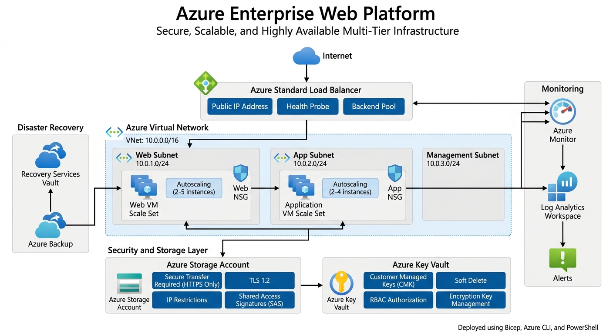

# Azure Enterprise Web Platform

A secure, scalable, and highly available Azure infrastructure solution designed to support a multi-tier web application environment.

## Project Overview

Azure Enterprise Web Platform is a cloud infrastructure project built on Microsoft Azure that demonstrates enterprise-grade architecture principles, Infrastructure as Code (IaC), security best practices, monitoring, scalability, and disaster recovery.

The solution simulates a real-world business environment hosting a mission-critical web application. It leverages Azure-native services to provide high availability, secure storage, centralized monitoring, automated infrastructure deployment, and backup capabilities.

This project was implemented using Bicep, Azure CLI, and PowerShell to showcase multiple deployment and management approaches commonly used by cloud engineers and cloud architects.

---

## Business Scenario

A growing organization requires a cloud-native platform capable of hosting a business-critical web application while ensuring:

- High Availability
- Automatic Scaling
- Secure Data Storage
- Centralized Monitoring
- Disaster Recovery
- Infrastructure Automation

To address these requirements, a multi-tier Azure architecture was designed and deployed using Infrastructure as Code principles.

---

## Architecture



---

## Solution Architecture

The platform follows a multi-tier architecture consisting of:

### Networking Layer

- Azure Virtual Network (10.0.0.0/16)
- Web Subnet (10.0.1.0/24)
- Application Subnet (10.0.2.0/24)
- Management Subnet (10.0.3.0/24)

### Security Layer

- Network Security Groups (NSGs)
- Azure Key Vault
- Customer Managed Encryption Keys (CMK)
- Secure Transfer Enforcement
- IP-Based Storage Access Restrictions
- Shared Access Signatures (SAS)

### High Availability Layer

- Azure Standard Load Balancer
- Health Probes
- Backend Pools
- Virtual Machine Scale Sets

### Monitoring Layer

- Azure Monitor
- Log Analytics Workspace
- Alerting Framework

### Disaster Recovery Layer

- Recovery Services Vault
- Azure Backup Policies

---

## Key Features

### Network Segmentation

The infrastructure is logically segmented into dedicated subnets for web, application, and management workloads to improve security and maintainability.

### Network Security

Network Security Groups enforce least-privilege access controls and isolate application tiers from unnecessary exposure.

### High Availability

Azure Standard Load Balancer distributes incoming traffic across multiple virtual machine instances to eliminate single points of failure.

### Automatic Scaling

Virtual Machine Scale Sets automatically increase or decrease compute capacity based on resource demand.

### Secure Storage

Azure Storage is configured with:

- HTTPS-only access
- TLS 1.2 enforcement
- Network access restrictions
- Shared Access Signatures (SAS)
- Encryption at rest

### Encryption & Key Management

Azure Key Vault provides centralized management of encryption keys through Customer Managed Keys (CMK).

### Monitoring & Observability

Azure Monitor and Log Analytics provide visibility into application and infrastructure health, performance, and operational metrics.

### Backup & Recovery

Azure Backup protects workloads through Recovery Services Vault and backup policies designed to support recovery objectives.

---

## Technologies Used

### Azure Services

- Azure Virtual Network
- Azure Network Security Groups
- Azure Standard Load Balancer
- Azure Virtual Machine Scale Sets
- Azure Storage Account
- Azure Key Vault
- Azure Monitor
- Azure Log Analytics Workspace
- Azure Backup
- Recovery Services Vault

### Infrastructure as Code

- Bicep

### Automation

- Azure CLI
- PowerShell

---

## Infrastructure as Code

The entire environment is defined using reusable Bicep modules.

```text
infrastructure/
│
├── main.bicep
│
└── modules/
    ├── network.bicep
    ├── nsg.bicep
    ├── storage.bicep
    ├── keyvault.bicep
    ├── loadbalancer.bicep
    ├── vmss.bicep
    ├── monitor.bicep
    └── backup.bicep
```

---

## Repository Structure

```text
azure-enterprise-web-platform/
│
├── README.md
│
├── architecture/
│   └── Azure-Enterprise-Web-Platform.png
│
├── infrastructure/
│   ├── main.bicep
│   └── modules/
│
├── scripts/
│   ├── networking/
│   ├── load-balancer/
│   ├── storage/
│   ├── vmss/
│   └── backup/
│
├── docs/
│
└── screenshots/
```

---

## Skills Demonstrated

- Azure Architecture Design
- Infrastructure as Code (IaC)
- Enterprise Networking
- Network Security
- Load Balancing
- High Availability Design
- Virtual Machine Scale Sets
- Cloud Security
- Azure Storage Security
- Azure Key Vault
- Monitoring and Observability
- Backup and Disaster Recovery
- PowerShell Automation
- Azure CLI Automation
- Bicep Development

---

## Deployment Approach

The platform can be deployed using:

### Bicep

```bash
az deployment group create \
  --resource-group <resource-group-name> \
  --template-file infrastructure/main.bicep
```

### Azure CLI

Deployment and resource management scripts are available within the scripts directory.

### PowerShell

PowerShell automation scripts can be used to provision and manage individual Azure services.

---

## Future Enhancements

Potential areas for expansion include:

- GitHub Actions CI/CD
- Azure Application Gateway
- Azure Bastion
- Private Endpoints
- Azure Policy
- Microsoft Defender for Cloud
- Managed Identities
- Azure Front Door

---

## Author

### Rostyslav Pron

Cloud and Infrastructure Engineer with a focus on Microsoft Azure, Infrastructure as Code, automation, and scalable cloud solutions.

#### Connect

- GitHub: https://github.com/YOUR-GITHUB-USERNAME
- LinkedIn: https://linkedin.com/in/YOUR-LINKEDIN-PROFILE

---

Azure Enterprise Web Platform demonstrates the design and deployment of a secure, scalable, and highly available Azure infrastructure environment using Azure services, Bicep, Azure CLI, and PowerShell.